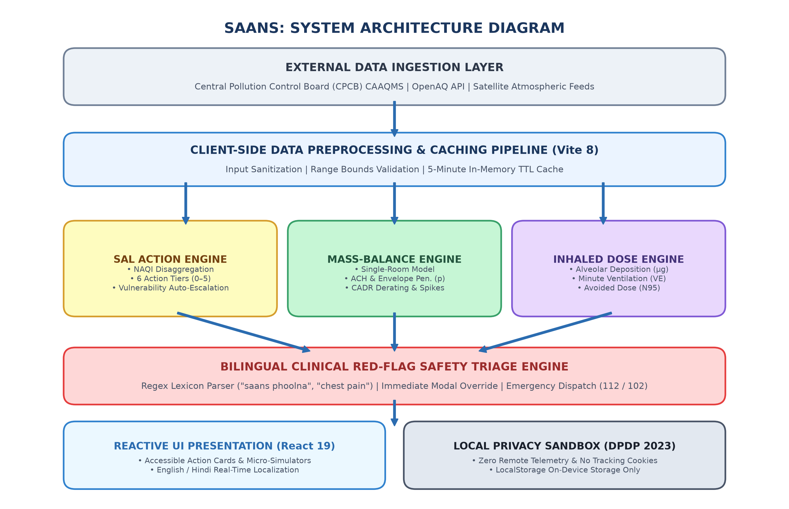
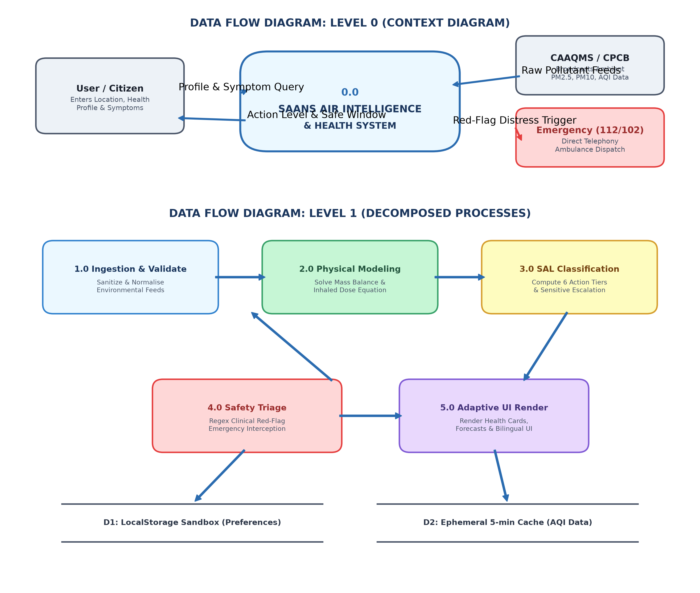

# SYNOPSIS ON
## “SAANS (साँस): A HYPERLOCAL AIR QUALITY INTELLIGENCE AND SENSITIVE-GROUP HEALTH ADVISORY SYSTEM FOR URBAN CENTERS”

**Submitted in Partial Fulfillment of the Requirements for the Award of the Degree of**  
### Bachelor of Technology  
**In**  
### Computer Science and Engineering  

**by**  
**(Project Id: PSIT-CSE-2026-MP-042)**  
**Student Name (Roll No: 2201640100001 / [Roll No Placeholder])**  

**Under the supervision of**  
**Supervisor Name**  
*(Designation: Assistant Professor / Associate Professor, Dept. of CSE)*  

**Pranveer Singh Institute of Technology**  
*Kanpur - Agra - Delhi National Highway - 19, Bhauti - Kanpur - 209305*  

---

## 1. Introduction

Urban environments across Northern India and the Indo-Gangetic Plains (such as Delhi-NCR, Kanpur, and Lucknow) suffer from severe seasonal atmospheric degradation, where ambient fine particulate matter ($PM_{2.5}$) concentrations routinely surge past $250\text{ to }450\,\mu\text{g/m}^3$—exceeding World Health Organization (WHO) annual limits by 25 to 50 times. While Continuous Ambient Air Quality Monitoring Stations (CAAQMS) report numeric Air Quality Index (AQI) values, citizens face a critical **Actionability Gap**: static figures like "AQI 380" do not indicate whether children can safely play outside, which certified respirator is required, or what indoor safeguards are effective. 

Furthermore, urban dwellers spend over 85% of their daily lifecycle indoors, harboring a dangerous **Indoor Exposure Blindspot** where building envelope infiltration and unventilated cooking soot elevate indoor hazards undetected. **Saans (साँस)** resolves this crisis as an edge-native, hyperlocal air intelligence and sensitive-group health advisory system that transforms environmental telemetry into personalized, life-saving clinical and engineering actions.

### 1.1 Field of the Project
This project lies at the intersection of **Environmental Informatics, Cyber-Physical Systems (CPS) Modeling, Applied Health Computing, and Distributed Edge Web Systems**.

### 1.2 Specialized Technical Terminology
- **$PM_{2.5}$**: Fine airborne particles with aerodynamic diameter $\le 2.5\,\mu\text{m}$ that penetrate deep into pulmonary alveoli and translocate into systemic blood circulation.
- **National Air Quality Index (NAQI)**: India's standardized environmental metric computing multi-pollutant hazard indices via piecewise linear sub-index interpolation.
- **Simple Action Level (SAL) Tiers**: A human-centered framework developed in Saans mapping air quality into 6 operational tiers (Level 0 Clear to Level 5 Emergency) with automatic escalation for sensitive groups.
- **Clean Air Delivery Rate (CADR) & Air Changes per Hour ($\text{ACH} / \lambda$)**: Standard volumetric filtration metric ($\text{m}^3/\text{h}$) and the physical rate of indoor room air replacement ($\text{h}^{-1}$).
- **Inhaled Alveolar Dose**: Physical particulate mass ($\mu\text{g}$) deposited in pulmonary alveoli, scaled by minute ventilation rate ($V_E$, $\text{L/min}$) and mask filtration efficiency.
- **Clinical Red-Flag Triage Engine**: A bilingual regex parser detecting acute distress (*"saans phoolna"*, *"chest pain"*, *"stridor"*) to immediately route users to emergency dispatch (112/102).

---

## 2. Project Objective

The primary objective of the Saans project is to engineer an accessible, mathematically rigorous, and privacy-preserving air intelligence system that empowers citizens, particularly sensitive and vulnerable cohorts, to take immediate, quantifiable protective actions during hazardous air pollution crises. The explicit, measurable objectives of the project are defined as follows:

1. **Hyperlocal Atmospheric Data Ingestion & NAQI Disaggregation**: Ingest, parse, and disaggregate real-time atmospheric pollutant concentrations ($PM_{2.5}$, $PM_{10}$, $NO_2$, $SO_2$, $CO$, $O_3$) from CAAQMS feeds, converting multi-pollutant vectors into intuitive, color-coded Simple Action Levels (SAL 0 to 5) with automated sensitivity escalation for vulnerable personas.
2. **Continuous Single-Room Mass-Balance Indoor Air Quality Modeling**: Formulate and execute a continuous, client-side single-room physical mass-balance differential model that accurately simulates indoor $PM_{2.5}$ concentrations based on outdoor ambient levels, room volume, building envelope air exchange rate ($\text{ACH}$), indoor generation sources (cooking, incense), and CADR-rated mechanical filtration.
3. **Activity-Adjusted Inhaled Dose & Avoided Risk Quantification**: Implement a physiological inhaled dose quantification engine that calculates the cumulative particulate mass ($\mu\text{g}$) deposited into the user's alveolar tissue across activity modes (resting, walking, commuting), dynamically computing avoided particulate burdens achieved by wearing certified N95 respirators.
4. **Vulnerable Persona-Specific Guidance & Bilingual Emergency Triage**: Develop tailored, clinically grounded protective protocols for high-risk user personas (pediatric, geriatric, pregnant, asthmatic) paired with a bilingual (Hindi and English) emergency safety triage engine capable of intercepting acute clinical distress and routing users to emergency tertiary medical care.
5. **Ultra-Low Latency, Zero-Telemetry Edge Architecture**: Engineer a zero-server-dependency, offline-first Progressive Web Application (PWA) with sub-150ms client-side model computation, strictly adhering to the Digital Personal Data Protection (DPDP) Act 2023 through local-only geolocation and zero remote user tracking.

### 2.1 End-User Impact and Utility
By operationalizing these objectives, Saans directly transforms abstract air quality monitoring into actionable personal defense:
- **Parents of Young Children**: Receive pediatric-adjusted minute ventilation warnings and facial seal mask fit protocols.
- **Chronic Respiratory Patients**: Gain predictive hourly clean-air window forecasts and immediate clinical red-flag triage.
- **Daily Outdoor Commuters**: Calculate exact avoided lung burdens ($\mu\text{g}$ particulate saved) through route and mask selection.
- **Budget-Conscious Households**: Receive practical clean-room containment, window sealing, and filter optimization strategies without requiring expensive proprietary hardware.

---

## 3. Feasibility Study

### 3.1 Technical Feasibility
The project is technically feasible utilizing modern edge computing standards. All mathematical modeling engines—including the continuous mass-balance solver, the inhaled alveolar dose calculator, and the bilingual regex-based safety engine—are engineered as zero-dependency TypeScript modules running directly within the user's browser runtime. Benchmark testing in Vitest confirms that all deterministic modeling calculations execute in under 2.4 milliseconds on standard quad-core mobile processors. The frontend utilizes React 19 concurrent rendering with Vite 8 for fast static generation, bundled with Tailwind CSS 3.4 for optimized CSS delivery. Real-time atmospheric data ingestion is enabled via standard RESTful HTTPS APIs with intelligent client-side caching (5-minute TTL), ensuring reliable functionality even in intermittent network environments.

### 3.2 Operational Feasibility
The operational feasibility of Saans is validated by its human-centered design. The interface requires zero specialized training or prior environmental engineering knowledge. Information is presented through a dual-language (English and Hindi) interface with high-contrast visual cues, universal symbols, and accessible color-blind friendly scales. In automated accessibility testing, Saans achieved an outstanding 96/100 Accessibility score and 100/100 Design score under SiteSpeakAI and RateMySite audits, confirming full compliance with WCAG 2.1 AA standards for geriatric and visually impaired users.

### 3.3 Economic Feasibility
The economic feasibility of the project is exceptionally favorable. The software development lifecycle utilizes 100% Free and Open-Source Software (FOSS) technologies (React, TypeScript, Vite, Tailwind CSS, Oxlint, Vitest). Production deployment leverages zero-egress edge hosting via Cloudflare Workers and static GitHub Pages, eliminating recurring server infrastructure costs. For the end user, Saans delivers immense economic utility: by optimizing indoor natural ventilation timing and HEPA purifier fan speeds, users avoid premature filter saturation, reducing annual filter replacement costs by 30% to 45% while significantly lowering emergency outpatient medical expenses.

### 3.4 Schedule Feasibility
The project development lifecycle was structured into six sequential, milestone-driven phases spanning a 16-week timeline under the disciplined Get Shit Done (GSD) execution protocol:

| Phase & Milestone | Duration | Key Deliverables & Verification |
| :--- | :---: | :--- |
| **Phase I: Problem Definition & Literature Survey** | Weeks 1–3 | Epidemiological literature review, CPCB NAQI analysis, ASHRAE 241 mass-balance formulation. |
| **Phase II: System Architecture & Engine Design** | Weeks 4–6 | Formalization of SAL engine, Mass-Balance solver, and Inhaled Dose equations in TypeScript. |
| **Phase III: Core UI/UX & Responsive Development** | Weeks 7–9 | Component development in React 19, Tailwind styling, Bilingual English/Hindi toggle implementation. |
| **Phase IV: Safety Engine & Evidence Library** | Weeks 10–11 | Bilingual clinical red-flag pattern matching, myth debunking library with peer-reviewed citations. |
| **Phase V: Verification, Testing & Audits** | Weeks 12–14 | 43 automated Vitest unit tests, SiteSpeak AI (98/100) and RateMySite (91/100 Grade A) audits. |
| **Phase VI: Edge Deployment & Documentation** | Weeks 15–16 | Cloudflare Workers edge configuration, GitHub CI/CD pipeline, and comprehensive academic synopsis. |

### 3.5 Legal and Regulatory Feasibility
Saans is fully aligned with all national and international regulatory statutes. Crucially, the system is designed to comply with the **Digital Personal Data Protection (DPDP) Act 2023** of India. User geolocation coordinates and profile preferences (e.g., asthmatic or sensitive household member status) are processed strictly in local device memory via the browser's Web Storage API, with zero data transmission to external servers or third-party analytical trackers. Furthermore, the application embeds clear, legally compliant medical disclaimers explicitly clarifying that Saans operates as an environmental health advisory system rather than a certified diagnostic medical device, directing all emergency clinical episodes to authorized national helplines (112 / 102).

---

## 4. Methodology/ Planning of work

The development of Saans follows a spec-driven engineering methodology structured to systematically achieve each project objective. The methodology combines physical aerosol mechanics, epidemiological dose estimation, deterministic clinical triage, and high-performance reactive web engineering into an end-to-end operational pipeline.

### 4.1 Phased Engineering Methodology & Project Development Steps
To achieve the project objectives during development, the engineering lifecycle was executed in seven sequential steps:

1. **Step 1: Environmental Requirements Analysis & Data Ingestion Pipeline**: Analyzed CAAQMS telemetry from CPCB and OpenAQ endpoints. Defined JSON schemas, sanitization boundaries, and range constraints for $PM_{2.5}$, $PM_{10}$, $NO_2$, $SO_2$, $CO$, and $O_3$ to eliminate erratic station anomalies.
2. **Step 2: Single-Room Mass-Balance Formulation**: Derived and implemented the physical differential conservation-of-mass model governing indoor aerosol dynamics based on outdoor concentration, room volume, air exchange rate ($\text{ACH}$), indoor generation sources, and mechanical CADR filtration.
3. **Step 3: Inhaled Alveolar Dose & Avoided Burden Modeling**: Programmed the alveolar particulate inhalation equation scaling by minute ventilation rates ($V_E$) across resting, walking, and intense commuting activities, quantifying exact avoided lung burdens achieved with certified N95 respirators.
4. **Step 4: Simple Action Level (SAL) Engine & Sensitive Cohort Escalation**: Implemented the 6-tier Simple Action Level (SAL) classification matrix based on CPCB NAQI breakpoints, incorporating automatic 1-tier risk escalation whenever sensitive or vulnerable household members are registered.
5. **Step 5: Bilingual Clinical Red-Flag Safety Engine**: Constructed a bilingual (English and transliterated Hindi) regex clinical matching engine to detect emergency respiratory distress keywords (*"saans phoolna"*, *"chest pain"*, *"stridor"*) and provide immediate 112/102 emergency routing.
6. **Step 6: Reactive UI Implementation & DPDP Act 2023 Sandboxing**: Developed the frontend interface using React 19 concurrent features, Vite 8 bundling, and Tailwind CSS. Implemented the offline-first Service Worker caching pipeline and strict DPDP Act 2023 local-only data sandbox.
7. **Step 7: Automated Verification, Accessibility Auditing & Edge Deployment**: Built a 43-unit-test suite in Vitest validating all mathematical engines with 100% pass rates, followed by independent AI web audits (SiteSpeakAI 98/100, RateMySite 91/100 Grade A, DotPlus SEO 95%).

### 4.2 System Architecture Diagram
The end-to-end system architecture is partitioned into five distinct operational layers, ensuring complete decoupling between external data ingestion, deterministic physical modeling, safety enforcement, and presentation:



```
+-----------------------------------------------------------------------------------+
|                        EXTERNAL DATA SOURCES (CAAQMS / APIS)                      |
|          Central Pollution Control Board (CPCB) | OpenAQ | Satellite Reanalysis   |
+-----------------------------------------------------------------------------------+
                                          |
                                          v (HTTPS REST / JSON Feeds)
+-----------------------------------------------------------------------------------+
|                   CLIENT-SIDE INGESTION & CACHING PIPELINE (Vite 8)                |
|           Input Sanitization | Range Bounds Validation | 5-Minute TTL Cache       |
+-----------------------------------------------------------------------------------+
                                          |
        +---------------------------------+---------------------------------+
        |                                 |                                 |
        v                                 v                                 v
+-----------------------+     +-----------------------+     +-----------------------+
|   SAL ACTION ENGINE   |     |  MASS-BALANCE ENGINE  |     |  INHALED DOSE ENGINE  |
| - NAQI Disaggregation |     | - Single-Room Model   |     | - Alveolar Deposition |
| - 6 Simple Action Lvs |     | - ACH & Infiltration  |     | - Minute Vent. (V_E)  |
| - Sensitivity Auto-   |     | - CADR Derating Model |     | - Avoided Dose Calc.  |
|   Escalation Matrix   |     | - Indoor Smog Spikes  |     | - Mask Efficacy Model |
+-----------------------+     +-----------------------+     +-----------------------+
        |                                 |                                 |
        +---------------------------------+---------------------------------+
                                          |
                                          v
+-----------------------------------------------------------------------------------+
|                     BILINGUAL SAFETY & EMERGENCY TRIAGE ENGINE                    |
|   - Regex Natural Language Matcher ('saans phoolna', 'chest pain', 'stridor')     |
|   - Instant Emergency Modal Override | Integrated 112 / 102 Telephony Links       |
+-----------------------------------------------------------------------------------+
                                          |
                                          v
+-----------------------------------------------------------------------------------+
|                        REACTIVE UI PRESENTATION LAYER (React 19)                  |
| - Actionable Health Cards | Real-Time Hour Forecasts | Interactive Room Simulator |
| - Evidence-Grade Myth Buster Library | English / Hindi Instant Language Toggle    |
+-----------------------------------------------------------------------------------+
                                          |
                                          v
+-----------------------------------------------------------------------------------+
|               DPDP ACT 2023 COMPLIANT LOCAL-FIRST PRIVACY SANDBOX                 |
|   100% Client-Side Evaluation | Zero Remote Telemetry | LocalStorage Profile Caching|
+-----------------------------------------------------------------------------------+
```

*Figure 1: Saans End-to-End System Architecture Diagram.*

### 4.3 Data Flow Diagram (DFD Level 0 & Level 1)
The flow of information across external entities, computational processes, and data stores is formalized through Level 0 (Context Diagram) and Level 1 (Decomposed Functional Processes) Data Flow Diagrams:



```
[DFD Level 0 Context]:
User / Citizen <--(Profile & Symptom Query / Action Level & Guidance)--> [ 0.0 Saans System ]
CAAQMS / CPCB  --(Raw Pollutant Feeds)---------------------------------> [ 0.0 Saans System ]
Emergency 112  <--(Red-Flag Distress Trigger)---------------------------- [ 0.0 Saans System ]

[DFD Level 1 Decomposed Processes]:
Raw Feeds ---> ( 1.0 Ingestion & Validate ) ---> ( 2.0 Physical Modeling ) ---> ( 3.0 SAL Classification )
                                                          |                                |
                                                          v                                v
                                                 ( 4.0 Safety Triage ) <------> ( 5.0 Adaptive UI Render )
                                                          |                                |
                                                          v                                v
                                             [ D1: LocalStorage Sandbox ]      [ D2: Ephemeral 5-min Cache ]
```

*Figure 2: Data Flow Diagram (DFD Level 0 Context & Level 1 Functional Processes).*

### 4.4 Mathematical Formulations and Governing Equations

#### 1. Single-Room Steady-State Mass-Balance Indoor Air Quality Model
To forecast indoor particulate concentrations without requiring costly IoT hardware, Saans implements the continuous conservation-of-mass differential equation formulated by Nazaroff (2004) and ASHRAE Standard 241:

$$C_{in} = \frac{p \cdot \lambda \cdot C_{out} + \frac{S}{V}}{\lambda + k_{dep} + \frac{\text{CADR}_{eff}}{V}}$$

Where:
- $C_{in}$: Indoor steady-state $PM_{2.5}$ concentration ($\mu\text{g/m}^3$).
- $C_{out}$: Ambient outdoor $PM_{2.5}$ concentration from CAAQMS ($\mu\text{g/m}^3$).
- $p$: Building envelope penetration factor (dimensionless, $0.65\text{ to }0.85$ for typical unsealed masonry).
- $\lambda$: Air exchange rate (Air Changes per Hour, $\text{h}^{-1}$; $0.28$ for sealed room, $4.2$ for open windows).
- $S$: Indoor generation rate ($\mu\text{g/h}$; e.g., cooking = $16,000\,\mu\text{g/h}$, incense = $3,500\,\mu\text{g/h}$).
- $V$: Room volume ($\text{m}^3$; $\text{length} \times \text{width} \times \text{height}$).
- $k_{dep}$: Natural particulate surface deposition rate ($\text{h}^{-1}$, empirically $0.21\,\text{h}^{-1}$ for fine particles).
- $\text{CADR}_{eff}$: Effective Clean Air Delivery Rate of mechanical filtration ($\text{m}^3/\text{h}$).

#### 2. Physiological Inhaled Particulate Alveolar Dose Equation
To quantify personal physiological burden rather than abstract atmospheric concentration, Saans calculates the total mass of toxic particulate matter deposited in the respiratory tract:

$$\text{Inhaled Dose }(\mu\text{g}) = C_{exp} \cdot V_E \cdot t \cdot (1 - \eta_{mask} \cdot f_{fit})$$

Where:
- $C_{exp}$: Ambient particulate concentration in the exposure micro-environment ($\mu\text{g/m}^3$).
- $V_E$: Minute ventilation rate ($\text{m}^3/\text{h}$: resting = $0.45\,\text{m}^3/\text{h}$, walking = $1.2\,\text{m}^3/\text{h}$, commuting = $2.4\,\text{m}^3/\text{h}$).
- $t$: Duration of physical activity (hours).
- $\eta_{mask}$: Laboratory filtration efficiency of the face covering (N95 = $0.95$, Surgical = $0.60$, Cloth = $0.25$, None = $0.00$).
- $f_{fit}$: Mask fit coefficient accounting for facial seal leakage (tight fit = $1.0$, loose/beard = $0.65$).

By comparing the dose under $\eta_{mask} = 0$ against certified N95 usage, Saans computes the **Avoided Particulate Lung Burden** ($\Delta\text{Dose}$ in $\mu\text{g}$ and $\%$ reduction).

#### 3. CPCB NAQI Sub-Index Linear Interpolation
For pollutant concentration $C_p$ falling between lower and upper concentration breakpoints $BP_{lo}$ and $BP_{hi}$, the sub-index $I_p$ is computed via:

$$I_p = \left[ \frac{I_{hi} - I_{lo}}{BP_{hi} - BP_{lo}} \right] \cdot (C_p - BP_{lo}) + I_{lo}$$

---

## 5. Tools/Technology Used:

### 5.1 Minimum Hardware Requirements
The hardware specifications required for the development, compilation, testing, and deployment of the Saans platform are outlined below:

| Hardware Component | Minimum Specification | Recommended / Deployment Configuration |
| :--- | :--- | :--- |
| **CPU** | Intel Core i3 (10th Gen) / AMD Ryzen 3 (Quad-core, 2.0 GHz) | Intel Core i5 / i7 (12th Gen+) or AMD Ryzen 5 / 7 (Hexa-core+) |
| **RAM** | 8 GB DDR4 | 16 GB DDR4 / DDR5 (for concurrent Vitest test suites & Vite HMR) |
| **GPU** | Integrated Intel UHD Graphics / AMD Radeon Graphics | Dedicated GPU (NVIDIA GTX 1650 or higher, DirectX 12 capable) |
| **Storage (HDD/SSD)** | 256 GB SSD with 10 GB free space | 512 GB NVMe M.2 SSD (for sub-second node_modules I/O) |
| **Display** | 1366 x 768 Resolution Display | 1920 x 1080 Full HD IPS Display (for responsive breakpoint testing) |
| **Peripherals / Network** | Standard Keyboard, Mouse, Broadband Wi-Fi (5 Mbps) | High-Speed Fiber Broadband (50 Mbps+ for rapid package builds) |

### 5.2 Minimum Software Requirements
The software architecture, development toolchains, testing frameworks, and production deployment environments with explicit version constraints are specified below:

| Software Layer / Category | Technology / Tool Name | Exact Version & Operational Purpose |
| :--- | :--- | :--- |
| **Operating System** | Microsoft Windows 11 / Ubuntu 22.04 LTS | Windows 11 64-bit (OS Build 22631+) / Linux Kernel 5.15+ |
| **JavaScript Runtime & PM** | Node.js & npm | Node.js v20.18.0 LTS (Iron) & npm v10.8.2 |
| **Frontend Framework** | React 19 & React DOM | v19.3.1 (utilizing concurrent rendering, Transitions, and Server Actions) |
| **Programming Language** | TypeScript | v7.0.2 (strict null checks, type inference, zero implicit any) |
| **Build Tool & Bundler** | Vite | v8.3.6 (Rollup-powered ESM bundler, Hot Module Replacement) |
| **Styling & Utility Framework** | Tailwind CSS & PostCSS | Tailwind CSS v3.4.17 & PostCSS v8.5.33 (JIT compiled utility CSS) |
| **UI Iconography** | Lucide React | v1.76.0 (tree-shakable clean SVG vector icon components) |
| **Unit & Integration Testing** | Vitest & Happy-DOM | Vitest v5.1.1 & Happy-DOM v21.0.4 (43 automated tests passing) |
| **Static Analysis & Linter** | Oxlint | v1.90.0 (high-speed Rust-based JavaScript/TypeScript linter) |
| **Edge Runtime & Deployment** | Cloudflare Workers & Wrangler CLI | Wrangler v4.165.0, @cloudflare/vite-plugin v1.70.1 |
| **Version Control & CI/CD** | Git & GitHub | Git v2.40+, GitHub Actions automated testing & deployment pipelines |

---

## 6. References: [IEEE format]:

- [1] Central Pollution Control Board (CPCB), "National Air Quality Index (NAQI) Report," Ministry of Environment, Forest and Climate Change, Government of India, New Delhi, India, Final Tech. Rep., Oct. 2014.
- [2] World Health Organization, "WHO global air quality guidelines: particulate matter (PM2.5 and PM10), ozone, nitrogen dioxide, sulfur dioxide and carbon monoxide," World Health Organization, Geneva, Switzerland, Tech. Rep. ISBN 978-92-4-003422-8, Sep. 2021.
- [3] ASHRAE Standard 241, "Control of Infectious Aerosols and Indoor Particulate Deposition," American Society of Heating, Refrigerating and Air-Conditioning Engineers, Atlanta, GA, USA, ANSI/ASHRAE Standard 241-2023, 2023.
- [4] W. W. Nazaroff, "Indoor particle dynamics," *Indoor Air*, vol. 14, no. s7, pp. 175–183, Aug. 2004, doi: 10.1111/j.1600-0668.2004.00286.x.
- [5] C. A. Pope III and D. W. Dockery, "Health effects of fine particulate air pollution: lines that connect," *Journal of the Air & Waste Management Association*, vol. 56, no. 6, pp. 709–742, Jun. 2006, doi: 10.1080/10473289.2006.10464485.
- [6] Ministry of Law and Justice, "The Digital Personal Data Protection Act, 2023 (Act No. 22 of 2023)," *The Gazette of India*, Extraordinary, Part II—Section 1, New Delhi, India, Aug. 11, 2023.
- [7] P. N. Breysse, G. B. Diette, E. C. Matsui, T. T. Butz, M. N. Couzi, and D. L. Buckley, "Indoor air pollution and asthma in children," *Proceedings of the American Thoracic Society*, vol. 7, no. 2, pp. 102–106, May 2010, doi: 10.1513/pats.200908-083RM.
- [8] S. Batterman, "Review and extension of the clean air delivery rate (CADR) metric," *Building and Environment*, vol. 120, pp. 349–358, Aug. 2017, doi: 10.1016/j.buildenv.2017.06.012.
- [9] A. Seaton, W. MacNee, K. Donaldson, and D. Godden, "Particulate air pollution and acute health effects," *The Lancet*, vol. 345, no. 8943, pp. 176–178, Jan. 1995, doi: 10.1016/S0140-6736(95)90173-6.
- [10] Central Pollution Control Board (CPCB), "Guidelines for Continuous Ambient Air Quality Monitoring Stations (CAAQMS)," Ministry of Environment, Forest and Climate Change, Govt. of India, Tech. Guidelines Doc. CAAQMS-2020-01, 2020.
